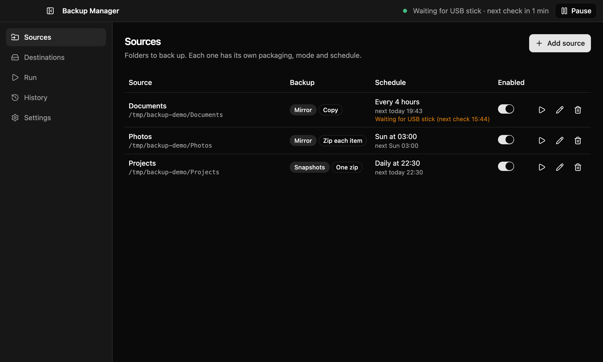
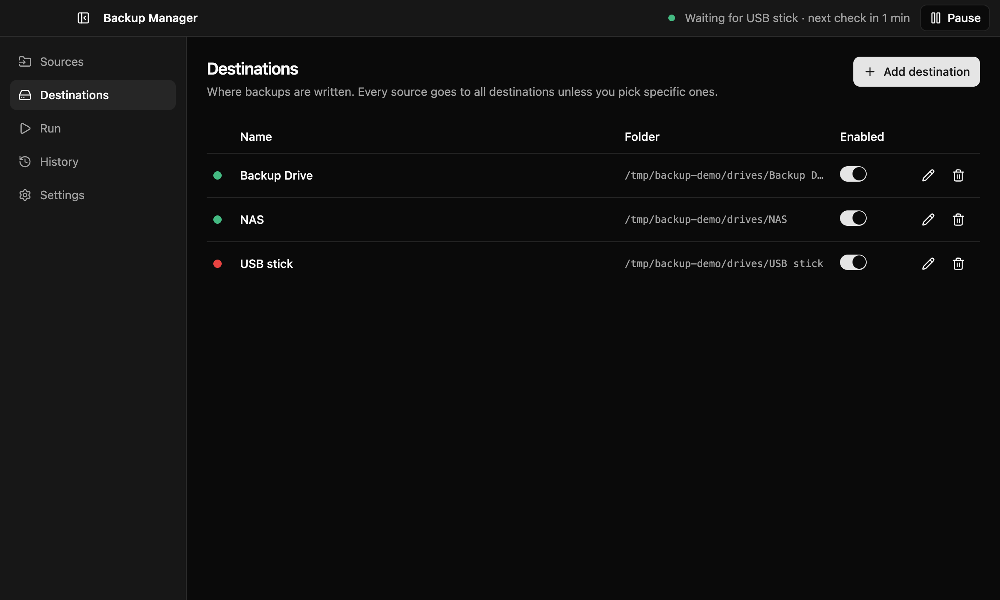
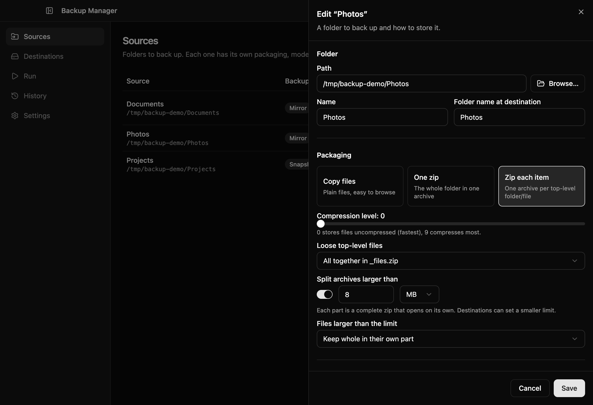
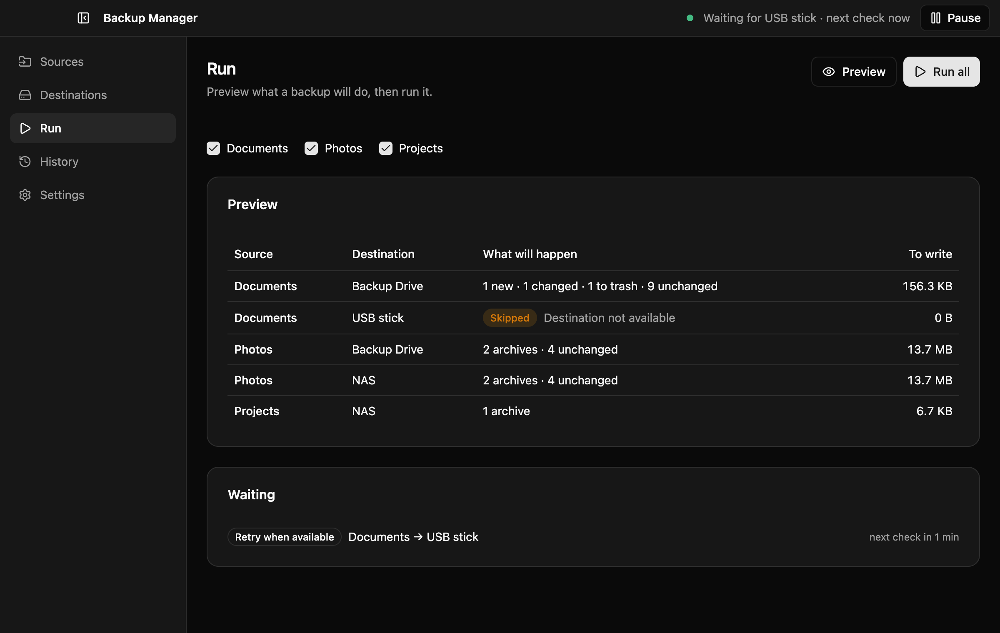
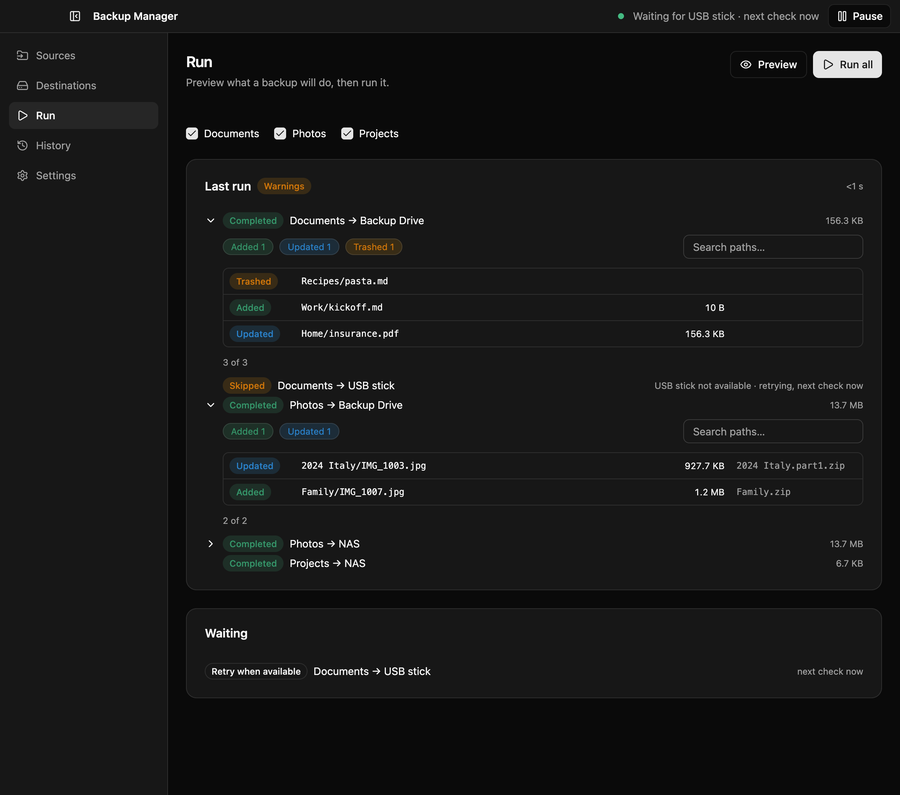
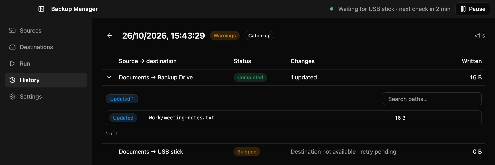

# Backup Manager

A desktop app for macOS, Windows and Linux that backs up the folders you choose to one or more
destination folders: an external drive, a NAS share, or a cloud folder synced by its own client
(OneDrive, Dropbox, iCloud Drive…). It runs from the menu bar / system tray, on a schedule, and
copes with laptops: missed runs catch up, unplugged drives are retried, interrupted runs recover.



- **Per-folder options.** Each source is mirrored (one up-to-date copy) or snapshotted (a dated
  copy per run), and stored as plain files, one zip, or one zip per top-level item.
- **Safe by default.** Deleted files go to a `.trash` folder; nothing is written when a drive is
  missing; half-written files are never left looking finished.
- **Zip size limits.** Large archives split into parts that each open on their own (useful for
  FAT32 drives and cloud upload limits).
- **See what changed.** Every run records the files added, updated, removed or skipped.

Backups are ordinary files and zips: you never need this app to get your data back.

- [Install](#install)
- [Usage](#usage)
- [Development](#development)

## Install

There are no published releases yet: build the installer for your system from source. You need
[Node.js](https://nodejs.org/) 22.12 or later (20.19+ also works) and git.

```bash
git clone <repository-url> backup-manager
```

```bash
cd backup-manager && npm install
```

Then build for the system you are on (each installer is built on its own OS):

| System  | Command               | Output in `dist/`                    |
| ------- | --------------------- | ------------------------------------ |
| macOS   | `npm run build:mac`   | `backup-manager-<version>.dmg`       |
| Windows | `npm run build:win`   | `backup-manager-<version>-setup.exe` |
| Linux   | `npm run build:linux` | `.AppImage` and `.deb`               |

The builds are not code-signed:

- **macOS:** open the `.dmg`, drag Backup Manager to Applications. On first launch macOS blocks
  it; open **System Settings → Privacy & Security** and click **Open Anyway**.
- **Windows:** run the setup file; if SmartScreen appears, click **More info → Run anyway**.
- **Linux:** make the AppImage executable (`chmod +x`) and run it, or install the `.deb`.

## Usage

### 1. Add destinations

A destination is a folder that already exists: a folder on an external drive, a mounted NAS share,
or your OneDrive folder. The dot shows whether it is reachable right now.



Backup Manager never creates a destination folder itself. If a drive is unplugged, its mount point
is missing and the backup is skipped instead of filling up your internal disk.

Each destination can cap zip part sizes (for example 4095 MB on a FAT32 drive) and force big files
to be split into chunks.

### 2. Add sources

A source is a list of files and folders to back up together, with one name, schedule and set of
destinations. Click **Add source**, add files and folders (on macOS one **Add…** picks both; on
Windows and Linux use **Add folder…** and **Add files…**), and choose how to store them. Each file
or folder is stored under its own name, so two in one source can't share a name.



**Packaging**

| Option        | Result at the destination                                                                                                |
| ------------- | ------------------------------------------------------------------------------------------------------------------------ |
| Copy files    | The files themselves, easy to browse                                                                                     |
| One zip       | Everything in one archive                                                                                                |
| Zip each item | Inside each folder, one archive per entry (its loose files individually or in `_files.zip`); one archive per listed file |

**Mode**

- **Mirror** keeps one up-to-date copy and writes only what changed. When a file is deleted from
  the source, the backup either moves it to `.trash` (default, emptied after the days you choose),
  deletes it, or keeps it.
- **Snapshots** write a new dated copy on every run. Retention always keeps at least N snapshots and
  can delete those older than X days.

**Split archives larger than** turns on zip parts: an archive over the limit becomes
`Photos.part1.zip`, `Photos.part2.zip`, … and each opens on its own. A file bigger than the limit
either gets a part of its own or is cut into raw chunks (`.001`, `.002`, …). In mirror mode files
stay in the part they are already in, so one changed photo rewrites, and re-uploads, only one part.

Each source also has **exclusions** (glob patterns such as `*.tmp` or `node_modules/`, on top of
the global ones in Settings), its **destinations** (all, or a selection) and a **schedule**: manual
only, every few hours, daily, or weekly on chosen days.

What lands where, for a source with folder name `S` holding a folder `Photos` and a file
`tax.pdf`:

| Mode     | Copy files                                  | One zip                   | Zip each item                                             |
| -------- | ------------------------------------------- | ------------------------- | --------------------------------------------------------- |
| Mirror   | `S/Photos/…`, `S/tax.pdf`                   | `S/S.zip`                 | `S/Photos/<entry>.zip`, `S/tax.pdf.zip`                   |
| Snapshot | `S/2026-10-26_154307/Photos/…`, `…/tax.pdf` | `S/2026-10-26_154307.zip` | `S/2026-10-26_154307/Photos/<entry>.zip`, `…/tax.pdf.zip` |

A mirror also keeps a few hidden items of its own in `S/`: `.trash/` for removed files,
`.backup-manager.json` (zip mirrors) and `.backup-manager-layout`. A file or folder in your
source named like one of those is skipped with a warning. Mirror backups made by earlier versions
(in `S/current/`, or a folder's contents directly in `S/`) are moved into `S/<folder>/` on their
next run, by renaming only; zip mirrors are rebuilt once.

### 3. Preview and run

The **Run** screen previews what a backup will do before it does it: new and changed files, files
going to the trash, archives to rewrite, and destinations that are not available.



**Run all** (or the ▶ button on a source) starts a backup with live progress and a Cancel button.
When it ends, expand any job to see the exact files it changed, with filters and search. For zip
backups the last column names the part that holds each file.



### 4. Let it run on schedule

Close the window and Backup Manager keeps running in the menu bar / system tray. Its menu shows the
status and offers Run all now, Cancel, Pause (for 1 hour or until resumed) and Quit. Turn on
**Launch at login** in Settings to have it start hidden when you log in.

- **Missed runs** (the computer was off or asleep) run once as soon as the app is running again.
- **A missing drive** is skipped and retried when it comes back: checks happen 1, 2, 3, 4 and
  5 minutes after the skip, then every 5 minutes, and right away when the computer wakes up or is
  plugged in. The top bar and the Sources list show "Waiting for USB stick · next check in N min".
- **Interrupted runs** (crash, forced shutdown, lid closed for good) are run again on the next
  start; leftover half-written files are cleaned up first.
- **Skip scheduled runs on battery** makes due backups wait until the computer is plugged in.

### 5. Check the history

**History** lists the last 200 runs with what started them (manual, scheduled, catch-up, retry,
recovery). Open a run to see each job and expand it for its file changes.



### Restoring

Copy the files back from the destination, or open the zips with your system's archive tool.

- Split archives (`.part1.zip`, `.part2.zip`, …) are independent zips: extract them all into the
  same folder.
- Chunked files (`.part3.zip.001`, `.002`, …) must be joined first: open the `.001` file with
  7-Zip, or join them with `cat Photos.part3.zip.* > Photos.part3.zip` (macOS/Linux) or
  `copy /b Photos.part3.zip.001+Photos.part3.zip.002 Photos.part3.zip` (Windows).
- Mirror backups keep removed files under `S/.trash/<timestamp>/` until the trash is emptied.

### Settings and data

Settings holds launch at login, notifications (after every run, only failures and warnings, or never),
battery behaviour, global exclusions, and **Export…/Import…** of the whole configuration. It also
shows where the configuration file lives; run history, scheduler state and change logs sit next to
it in the app's data folder.

## Development

```bash
npm install
```

```bash
npm run dev
```

`npm run dev` starts the app with hot reload. To keep test data away from your real configuration,
point it at a throwaway profile folder:

```bash
BM_USER_DATA=/tmp/bm-dev npm run dev
```

| Script                                            | What it does                                            |
| ------------------------------------------------- | ------------------------------------------------------- |
| `npm run dev`                                     | Run the app in development mode                         |
| `npm test`                                        | Run the test suite once (`npm run test:watch` to watch) |
| `npm run typecheck`                               | Type-check main/preload and renderer                    |
| `npm run format`                                  | Format with Prettier                                    |
| `npm run lint`                                    | ESLint                                                  |
| `npm run build`                                   | Type-check and build into `out/`                        |
| `npm start`                                       | Run the built app from `out/`                           |
| `npm run build:mac` / `build:win` / `build:linux` | Package installers into `dist/`                         |

### How it is built

Electron + electron-vite, React 19, TypeScript, Tailwind CSS v4 with shadcn/ui, zod for validation,
yazl for zip writing.

```
src/
  shared/       zod config schema, shared types, IPC channel contract
  main/
    engine/     backups: walk, plan, mirror, snapshot, zip parts, retention, history, change log
    scheduler/  schedules, run queue, catch-up, retries, crash recovery
    index.ts    window, tray, notifications, power events, wiring
    handlers.ts IPC handlers (every payload validated)
  preload/      exposes window.api to the renderer
  renderer/     React UI: screens/, components/, hooks/, lib/
tests/          vitest suites for engine, scheduler, main and shared code
docs/           design specs and plans, release smoke checklist, screenshots
```

- The **engine** and **scheduler** are plain Node with no Electron imports (a test enforces this),
  so they are tested directly against real temporary folders, with a fake clock for the scheduler.
- The renderer talks to the main process only through `window.api` (context isolation and sandbox
  on); main validates every payload.
- Every file is written to a `.bm-partial` sibling and renamed into place when complete, so a crash
  never leaves a half-written file looking finished.

### Tests

```bash
npm test
```

Tests run in the `Europe/Rome` time zone (set in `vitest.config.mts`) so schedule and DST tests are
deterministic. The UI has no automated tests; before a release, go through
[docs/smoke-checklist.md](docs/smoke-checklist.md) on each OS.

### Design documents

- [docs/superpowers/specs/2026-10-25-backup-manager-design.md](docs/superpowers/specs/2026-10-25-backup-manager-design.md):
  the base design.
- [docs/superpowers/specs/2026-10-26-zip-parts-retry-timing-change-history-design.md](docs/superpowers/specs/2026-10-26-zip-parts-retry-timing-change-history-design.md):
  zip parts, retry timing and change history.
- [docs/superpowers/plans/](docs/superpowers/plans/): the implementation plans.
