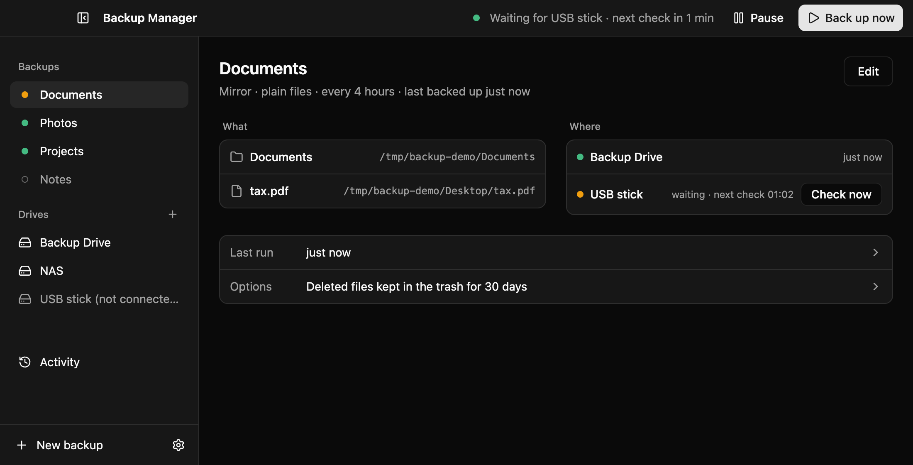
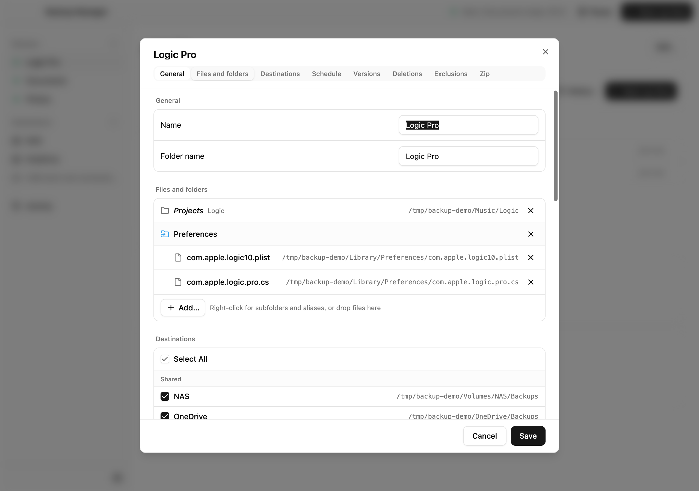
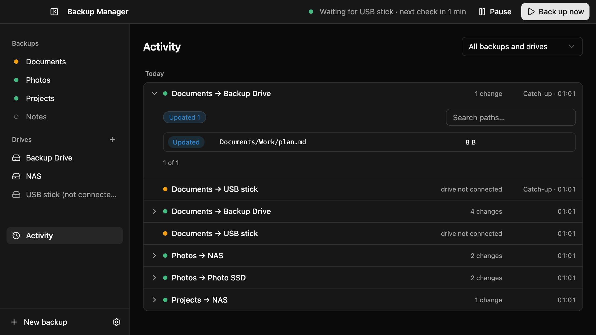
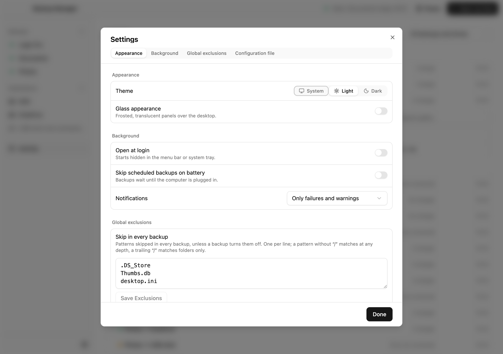
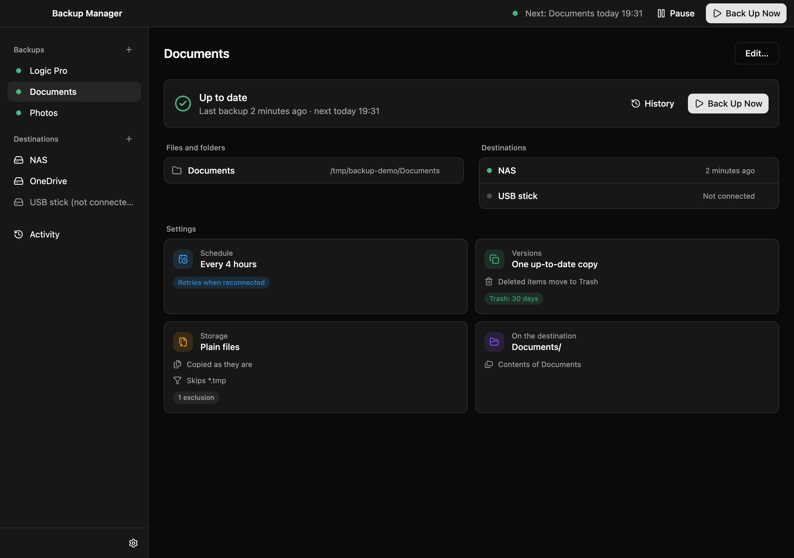

# Backup Manager

A small desktop app for macOS and Windows that backs up the files and folders you choose to an
external drive, a NAS, or a synced cloud folder such as OneDrive, on a schedule, from the menu
bar or system tray.

> [!WARNING]
> Backup Manager is a personal utility, built for my own needs with the help of AI coding tools.
> It is not a polished or audited product, and I make no promises about its reliability. Don't
> trust it as your only backup, and check that your backups contain what you expect before you
> rely on them.



## Features

- **Backups at a glance**: each backup shows its status, its files and folders, its destinations
  and its settings on one page.
- **Copy or versions**: keep one up-to-date copy, or a dated version on every run.
- **Plain files or zips**: one zip, or a zip per item, with optional size limits that split big
  archives into parts.
- **Your own layout**: put items into subfolders on the destination and rename them there, Finder
  style.
- **Laptop friendly**: missed runs catch up, unplugged drives are retried when they come back, and
  interrupted runs recover.
- **Safe defaults**: deleted files go to a trash folder, nothing is written when a drive is missing,
  and half-written files never look finished.
- **History**: every run records which files were added, updated or removed.
- **Light and dark themes**, with an optional frosted glass look.

Backups are ordinary files and zips, so you never need this app to get your data back.

## Screenshots

| Editing a backup                                      | Activity                                        |
| ----------------------------------------------------- | ----------------------------------------------- |
|  |       |
| **Settings**                                          | **Dark theme**                                  |
|             |  |

## Installation

Download the installer for your computer from the
[latest release](https://github.com/sbuicodev/backup-manager/releases/latest):

| Computer                  | File                                       |
| ------------------------- | ------------------------------------------ |
| Mac with Apple silicon    | `backup-manager-<version>.dmg`             |
| Windows PC (Intel or AMD) | `backup-manager-<version>-x64-setup.exe`   |
| Windows on ARM            | `backup-manager-<version>-arm64-setup.exe` |

The installers aren't code-signed, so the first launch needs one extra step:

- **macOS**: open **System Settings → Privacy & Security** and click **Open Anyway**.
- **Windows**: when SmartScreen appears, click **More info → Run anyway**.

## Development

You need [Node.js](https://nodejs.org/) 24.

```bash
git clone https://github.com/sbuicodev/backup-manager.git
```

```bash
cd backup-manager && npm install
```

```bash
npm run dev
```

| Command                   | What it does                                     |
| ------------------------- | ------------------------------------------------ |
| `npm run dev`             | Run the app with hot reload                      |
| `npm test`                | Run the test suite                               |
| `npm run typecheck`       | Type-check the whole project                     |
| `npm run build:mac`       | Build the macOS installer into `dist/`           |
| `npm run build:win`       | Build the Windows x64 installer (works on a Mac) |
| `npm run build:win:arm64` | Build the Windows on ARM installer               |

Set `BM_USER_DATA=/tmp/bm-dev` to keep test data away from your real configuration.

Built with Electron, React, TypeScript, Tailwind CSS and shadcn/ui. The backup engine and scheduler
are plain Node code under `src/main`, tested against real temporary folders. Every push runs the
tests on macOS and Windows; pushing a version tag (`npm version minor`, then
`git push --follow-tags`) builds the installers and publishes a release.

## License

[GPL-3.0](LICENSE). The software comes with no warranty of any kind.
