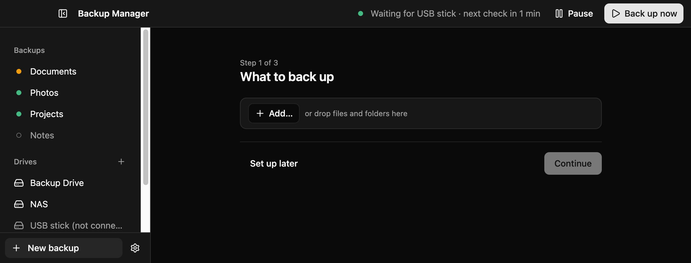
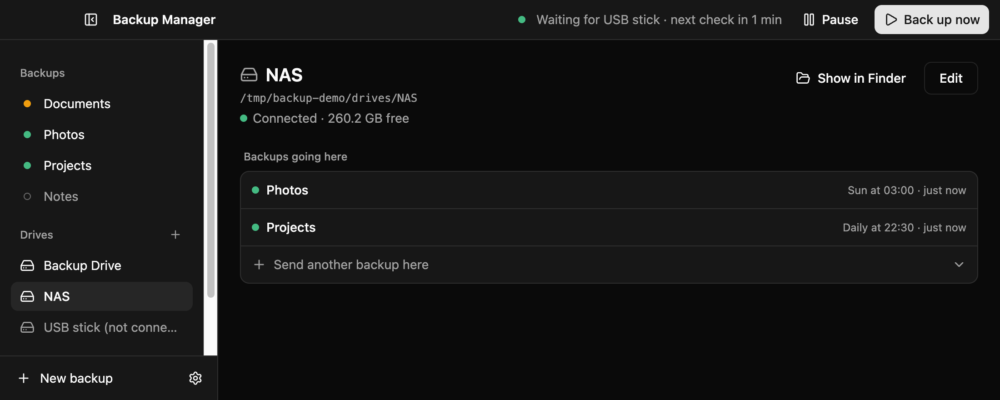

# Backup Manager

A desktop app for macOS, Windows and Linux that backs up the folders you choose to one or more
destination folders: an external drive, a NAS share, or a cloud folder synced by its own client
(OneDrive, Dropbox, iCloud Drive…). It runs from the menu bar / system tray, on a schedule, and
copes with laptops: missed runs catch up, unplugged drives are retried, interrupted runs recover.


- **Per-folder options.** Each source is mirrored (one up-to-date copy) or snapshotted (a dated
  copy per run), and stored as plain files, one zip, or one zip per top-level item.
- **Safe by default.** Deleted files go to a `.trash` folder; nothing is written when a drive is
  missing; half-written files are never left looking finished.
- **Zip size limits.** Large archives split into parts that each open on their own (useful for
  FAT32 drives and cloud upload limits).
- **See what changed.** Every run records the files added, updated, removed or skipped.

Backups are ordinary files and zips: you never need this app to get your data back.

- [Install](#install)
- [Usage](#usage)
- [Development](#development)

## Install

There are no published releases yet: build the installer for your system from source. You need
[Node.js](https://nodejs.org/) 22.12 or later (20.19+ also works) and git.

```bash
git clone <repository-url> backup-manager
```

```bash
cd backup-manager && npm install
```

Then build for the system you are on (each installer is built on its own OS):

| System  | Command               | Output in `dist/`                    |
| ------- | --------------------- | ------------------------------------ |
| macOS   | `npm run build:mac`   | `backup-manager-<version>.dmg`       |
| Windows | `npm run build:win`   | `backup-manager-<version>-setup.exe` |
| Linux   | `npm run build:linux` | `.AppImage` and `.deb`               |

The builds are not code-signed:

- **macOS:** open the `.dmg`, drag Backup Manager to Applications. On first launch macOS blocks
  it; open **System Settings → Privacy & Security** and click **Open Anyway**.
- **Windows:** run the setup file; if SmartScreen appears, click **More info → Run anyway**.
- **Linux:** make the AppImage executable (`chmod +x`) and run it, or install the `.deb`.

## Usage

The window has one sidebar: your **backups** (each with a status dot), your **drives**, and
**Activity**. Select something to see it on the right. **Back up now** in the top bar runs every
backup; hovering it shows what it would do ("Will copy 3 files (156 KB) · 1 drive not connected").

### 1. Create a backup

Click **New backup** at the bottom of the sidebar. Three steps:

1. **What to back up**: files and folders from anywhere. On macOS **Add…** picks both at once; on
   Windows and Linux use **Add folder…** and **Add files…**. You can also drop them from
   Finder or Explorer.
2. **Where it goes**: pick one or more drives, or **Other folder…** for a folder used by this
   backup only.
3. **How and when**: keep an up-to-date copy (a mirror) or dated versions, run every day at 22:00,
   every 4 hours, or only when you click Back up now.



**Create backup** saves it and starts its first run. **Set up later**, on any step, keeps what you
entered as a backup marked **Not set up**: it never runs until you open it, click
**Finish setting up**, and save it with at least one item and one drive.

A drive is a folder that already exists: on an external drive, a NAS share, or your OneDrive
folder. Backup Manager never creates it, so an unplugged drive is skipped instead of filling up
your internal disk. Add one with the **+** next to **Drives**.

### 2. See what goes where

A backup's page shows **What** it holds and **Where** it goes, with each drive's own status
("2 hours ago", "waiting · next check 15:40" with **Check now**, "failed · disk full"). Right-click
a drive row to open that backup's folder in Finder or Explorer. **Last run** opens it in Activity.


A drive's page shows whether it is connected, its free space, and every backup that goes to it.
**Send another backup here** adds one in a click.



### 3. Change a backup

Click **Edit**. Every setting is on one page, grouped like System Settings; nothing is saved until
you click **Save**, and leaving with unsaved changes asks first.


- **Where**: all shared drives or a selection, plus drives used by this backup only.
- **Schedule**: every few hours, every day, every week, or only when you click Back up now; and
  whether to retry when an unplugged drive comes back.
- **Versions**: an up-to-date copy (mirror) or dated versions, keeping at least N and deleting
  those older than X days.
- **Deletions** (mirror): a file deleted from your source goes to the backup's `.trash` (emptied
  after the days you choose), is deleted, or stays.
- **Exclusions**: patterns such as `*.tmp` or `node_modules/`, on top of the global ones.
- **Zip**: plain files, one zip, or a zip per item, with compression and an optional size limit
  that splits big archives into parts that each open on their own.

What lands where, for a backup with folder name `S` holding a folder `Photos` and a file
`tax.pdf`:

| Keep     | Plain files                                 | One zip                   | A zip per item                                            |
| -------- | ------------------------------------------- | ------------------------- | --------------------------------------------------------- |
| Copy     | `S/Photos/…`, `S/tax.pdf`                   | `S/S.zip`                 | `S/Photos/<entry>.zip`, `S/tax.pdf.zip`                   |
| Versions | `S/2026-10-26_154307/Photos/…`, `…/tax.pdf` | `S/2026-10-26_154307.zip` | `S/2026-10-26_154307/Photos/<entry>.zip`, `…/tax.pdf.zip` |

A mirror also keeps a few hidden items of its own in `S/`: `.trash/` for removed files,
`.backup-manager.json` (zip mirrors) and `.backup-manager-layout`. Mirror backups made by earlier
versions are moved into this layout on their next run, by renaming only; zip mirrors are rebuilt
once.

Right-click a backup in the sidebar to back it up now, pause it, duplicate it, show it in Finder,
or delete it.

### 4. Let it run on schedule

Close the window and Backup Manager keeps running in the menu bar / system tray. Its menu shows a
line per backup ("Documents — backed up 2 hours ago", "Photos — waiting for USB stick"; click one
to open it), plus Run all now, Cancel, Pause and Quit. Turn on **Launch at login** in Settings to
have it start hidden when you log in.

- **Missed runs** (the computer was off or asleep) run once as soon as the app is running again.
- **A missing drive** is skipped and retried when it comes back: checks happen 1, 2, 3, 4 and
  5 minutes after the skip, then every 5 minutes, and right away when the computer wakes up or is
  plugged in.
- **Interrupted runs** (crash, forced shutdown, lid closed for good) are run again on the next
  start; leftover half-written files are cleaned up first.
- **Skip scheduled runs on battery** makes due backups wait until the computer is plugged in.

### 5. Activity

**Activity** lists runs by day, with what started them when it was not you (scheduled, catch-up,
retry, recovery). Click a backup → drive row to see the files it changed, with filters and search;
filter the list to one backup or one drive. A running backup shows its progress at the top.


### Restoring

Copy the files back from the destination, or open the zips with your system's archive tool.

- Split archives (`.part1.zip`, `.part2.zip`, …) are independent zips: extract them all into the
  same folder.
- Chunked files (`.part3.zip.001`, `.002`, …) must be joined first: open the `.001` file with
  7-Zip, or join them with `cat Photos.part3.zip.* > Photos.part3.zip` (macOS/Linux) or
  `copy /b Photos.part3.zip.001+Photos.part3.zip.002 Photos.part3.zip` (Windows).
- Mirror backups keep removed files under `S/.trash/<timestamp>/` until the trash is emptied.

### Settings and data

Settings (the gear at the bottom of the sidebar, or ⌘, on macOS) holds launch at login, notifications (after every run, only failures and warnings, or never),
battery behaviour, global exclusions, and **Export…/Import…** of the whole configuration. It also
shows where the configuration file lives; run history, scheduler state and change logs sit next to
it in the app's data folder.

## Development

```bash
npm install
```

```bash
npm run dev
```

`npm run dev` starts the app with hot reload. To keep test data away from your real configuration,
point it at a throwaway profile folder:

```bash
BM_USER_DATA=/tmp/bm-dev npm run dev
```

| Script                                            | What it does                                            |
| ------------------------------------------------- | ------------------------------------------------------- |
| `npm run dev`                                     | Run the app in development mode                         |
| `npm test`                                        | Run the test suite once (`npm run test:watch` to watch) |
| `npm run typecheck`                               | Type-check main/preload and renderer                    |
| `npm run format`                                  | Format with Prettier                                    |
| `npm run lint`                                    | ESLint                                                  |
| `npm run build`                                   | Type-check and build into `out/`                        |
| `npm start`                                       | Run the built app from `out/`                           |
| `npm run build:mac` / `build:win` / `build:linux` | Package installers into `dist/`                         |

### How it is built

Electron + electron-vite, React 19, TypeScript, Tailwind CSS v4 with shadcn/ui, zod for validation,
yazl for zip writing.

```
src/
  shared/       zod config schema, shared types, IPC channel contract
  main/
    engine/     backups: walk, plan, mirror, snapshot, zip parts, retention, history, change log
    scheduler/  schedules, run queue, catch-up, retries, crash recovery
    index.ts    window, tray, notifications, power events, wiring
    handlers.ts IPC handlers (every payload validated)
  preload/      exposes window.api to the renderer
  renderer/     React UI: screens/, components/, hooks/, lib/
tests/          vitest suites for engine, scheduler, main and shared code
docs/           design specs and plans, release smoke checklist, screenshots
```

- The **engine** and **scheduler** are plain Node with no Electron imports (a test enforces this),
  so they are tested directly against real temporary folders, with a fake clock for the scheduler.
- The renderer talks to the main process only through `window.api` (context isolation and sandbox
  on); main validates every payload.
- Every file is written to a `.bm-partial` sibling and renamed into place when complete, so a crash
  never leaves a half-written file looking finished.

### Tests

```bash
npm test
```

Tests run in the `Europe/Rome` time zone (set in `vitest.config.mts`) so schedule and DST tests are
deterministic. The UI has no automated tests; before a release, go through
[docs/smoke-checklist.md](docs/smoke-checklist.md) on each OS.

### Design documents

- [docs/superpowers/specs/2026-10-25-backup-manager-design.md](docs/superpowers/specs/2026-10-25-backup-manager-design.md):
  the base design.
- [docs/superpowers/specs/2026-10-26-zip-parts-retry-timing-change-history-design.md](docs/superpowers/specs/2026-10-26-zip-parts-retry-timing-change-history-design.md):
  zip parts, retry timing and change history.
- [docs/superpowers/plans/](docs/superpowers/plans/): the implementation plans.
